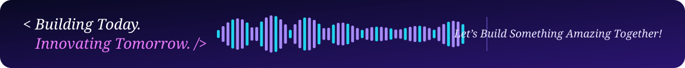

<table>
<tr>

<!-- ================= ABOUT ================= -->
<td width="30%" valign="top">

 

I'm a passionate Software Engineer who builds **scalable web applications**. I love solving real-world problems through technology and continuously learning new tools. 💜

💼 Working on scalable software solutions 
💻 Passionate about backend & full-stack development 
🌱 Continuously learning modern technologies 
🎯 Focused on clean code and innovation 
🤝 Open to collaborate on exciting projects

</td>

<!-- ================= TECH ================= -->
<td width="44%" valign="top" align="center">

 

<b>LANGUAGES</b> 
  
<b>FRONTEND</b> 
  
<b>BACKEND</b> 
  
<b>DATABASES</b> 
  
<b>TOOLS & OTHERS</b> 

</td>

<!-- ================= CONNECT ================= -->
<td width="26%" valign="top" align="center">

 

 
 
 

</td>
</tr>
</table>

<table>
<tr>

<!-- ================= STATS ================= -->
<td width="30%" valign="top" align="center">

 

 
 

</td>

<!-- ================= LANGUAGES ================= -->
<td width="35%" valign="top" align="center">

 

<!--  -->
</td>

<!-- ================= STREAK ================= -->
<td width="35%" valign="top" align="center">

 

</td>
</tr>
</table>

  

